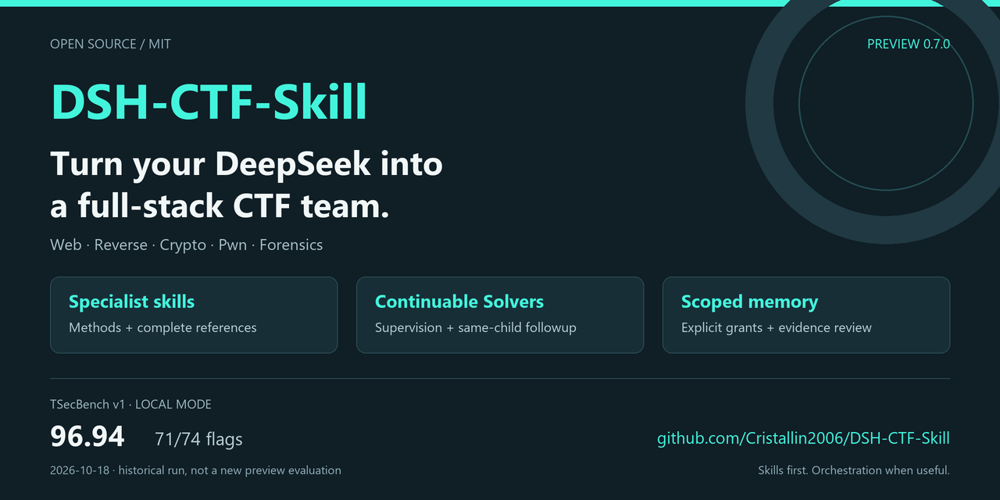
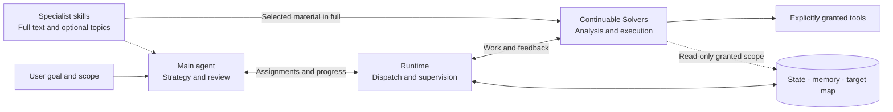

# DSH-CTF-Skill

[简体中文](README.md) | **English** | [日本語](README.ja.md)

[](LICENSE) [](https://www.npmjs.com/package/@deepseek-ai/dsh) [](https://github.com/Cristallin2006/DSH-CTF-Mode/actions/workflows/synthetic.yml)

> **Turn your DeepSeek into a full-stack CTF team.**

CTF and security analysis skills for [DeepSeek Harness (DSH)](https://github.com/deepseek-ai/deepseek-harness). Covers Web, reverse engineering, cryptography, Pwn, Android and traffic forensics, with optional continuable Solvers, structured memory and evidence review.



[Capabilities](#capabilities) · [Quick start](#quick-start) · [Usage](#usage) · [Architecture](#architecture) · [Benchmark](#local-benchmark-records) · [Documentation](#documentation)

## Capabilities

**The model chooses the investigation. The runtime maintains reliable state. Skills supply specialist methods.** Work directly on simple tasks; enable orchestration when the work benefits from delegation.

| Capability | What it provides | Read more |
|---|---|---|
| Specialist skills | Web, reverse engineering, cryptography, Pwn, Android and forensics, with optional references | [Skills](skills/) |
| Solo or coordinated work | A CTF preset with mode selection and readiness controls in Web | [CTF mode](docs/CTF-MODE.md) |
| Continuable Solvers | Independent child sessions, progress updates, guidance and continuation of the same work with its own history | [Orchestration](skills/analysis-orchestration/SKILL.md) |
| Memory and reusable methods | Sources, conditions, conflicts and revisions; scoped recall and explicitly reviewed, redacted method cards | [Knowledge library](skills/analysis-memory/references/knowledge-library.md) |
| Target maps and long tasks | Component relationships, goal dependencies and work coverage; complete paged assignments, followups and results | [Target map](skills/analysis-orchestration/references/target-map.md) · [Long tasks](skills/analysis-orchestration/references/long-tasks.md) |

<details>
<summary>Browse recent specialist additions</summary>

- **Web:** [WAF and allowlist differences](skills/ctf-web/references/waf-allowlist-differentials.md), [Elixir / BEAM applications](skills/ctf-web/references/elixir-beam-web.md).
- **Reverse engineering and artifacts:** [Static BEAM inventory](skills/re-triage/references/beam-artifacts.md), [saved-chunk assembly](skills/re-triage/references/evidence-chunks.md).
- **Cryptography and protocols:** [CRC models and oracle conditions](skills/ctf-crypto/references/crc-oracle-contracts.md), [layered protocols and connection state](skills/pwn-exploit/references/relay-session-contracts.md).
- **Local Pwn:** [SQLite extensions](skills/pwn-exploit/references/sqlite-extension.md), [seccomp evidence](skills/pwn-exploit/references/seccomp-evidence.md), [multi-stage experiments](skills/pwn-exploit/references/multi-stage-local.md).
- **Runtimes and lifetimes:** [Bundled runtimes](skills/pwn-exploit/references/bundled-runtime.md), [mallocng](skills/pwn-exploit/references/mallocng-evidence.md), [libxml2](skills/pwn-exploit/references/libxml2-state-lifetime.md), [nginx modules](skills/ghidra-static/references/nginx-module-analysis.md).
- **Windows:** [User-mode analysis](skills/pwn-exploit/references/windows-pwn.md), [native debug observation](skills/re-dynamic/references/windows-debug-channel.md).
- **Experimental branch workbench:** [Passive discovery, coordinates, saved evidence and MCP host checks](docs/RE-WORKBENCH.md). Device control and static writes have separate acceptance stages.

Choose topics for the current question. The host delivers required skills and references in full; other skills remain discoverable. See the [changelog](CHANGELOG.md) for details.

</details>

## Quick start

### 1. Run a local example

Requires Python 3.10+. Run these commands in a terminal; use `python` instead of `python3` on Windows.

```bash
git clone https://github.com/Cristallin2006/DSH-CTF-Mode.git
cd DSH-CTF-Mode
python3 examples/recovery/run.py
```

Expect `"ok": true`. This synthetic byte-recovery example needs no DSH, model service or live target. A native Solver and memory-permissions walkthrough is also available in [examples](examples/README.md).

### 2. Choose an installation

| Mode | Best for | Next step |
|---|---|---|
| Skills only | Existing DSH users who want specialist knowledge | Run the commands below |
| Full mode (experimental) | Task state, memory, continuable Solvers and CTF mode controls | Choose a native card or separate profile using [CTF mode setup](docs/CTF-MODE.md) |

Skills-only installation:

```bash
python3 tools/doctor.py --mode skills
python3 tools/setup.py --mode skills          # preview
python3 tools/setup.py --mode skills --apply  # install
```

Full mode requires Linux/WSL, Node.js 24+ and an installed DSH. Initialize state, configure your own model and register the host plugins using the [quick start](docs/QUICKSTART.md). Back up and pause/drain existing work before upgrading. Specialist tools are listed in [TOOLSET](TOOLSET.md).

> This page describes current **main**. [v0.7.0 Preview](https://github.com/Cristallin2006/DSH-CTF-Mode/releases/tag/v0.7.0) is an older archive that lacks later additions. Use main source for current features.

## Usage

After installing and enabling the native CTF preset, choose **Settings → Agent presets → Custom → CTF mode**. Select an automatic, prefer-solo or prefer-coordination preference; the session title shows the actual route and readiness. See [CTF mode](docs/CTF-MODE.md) for setup.

Send a task to the main agent, for example:

| Scenario | Example prompt |
|---|---|
| One challenge | Analyze `<attachment path>`, choose relevant skills, and provide a reproduction script, evidence and validation results. The authorized scope is `<scope>`. |
| Independent targets | Use orchestration for `<challenge directory>`. Delegate by independent target, declare skills and tools, and report each target's status. |
| Continue with new material | New material is at `<path>`. Find the original work, follow up with the same Solver, and reassess affected conclusions. |

Send guidance to the main session for forwarding to the Solver. Delivery, understanding and experimental verification are separate. The [Agent operations guide](docs/AGENT-OPERATIONS.md) covers prompts, intervention, pause and recovery.

## Architecture

The diagram shows coordinated work. In solo mode, the main agent uses specialist skills and its existing tools directly.



The main agent judges and reviews; Solvers do the assigned work. The runtime records state, delivery and permissions. Memory sharing is scoped, and changed premises require review. Full data flow, repository layout and operating boundaries are in [architecture](docs/ARCHITECTURE.md).

## Local benchmark records

Historical **TSecBench v1 local-mode** result supplied by the user; model label: **Deepseek**.

| Test time | Points earned | Composite score | Displayed completion | Correct flags | Fully correct tasks |
|---|---:|---:|---:|---:|---:|
| **2026-10-18 18:48** | **22300** | **96.94** | **95.9%** | **71/74** | **61/63** |

This local record is not an official leaderboard claim. The screenshot does not identify an exact model version or code revision, so it cannot establish gains from current main or any specific change. See [category results, previous records and evaluation context](docs/BENCHMARKS.md).

## Compatibility and validation

Plugins were validated on **Linux/WSL, DSH 0.1.5-rc.3, Node.js 24.21.0 and Python 3.10+**. Check compatibility on other host versions. Native Windows observation tools are included; full host integration was validated on Linux/WSL.

- Orchestration, target maps and the project method library are optional experimental features. Delegation benefits depend on task independence and handoff cost.
- Concurrency and context capacity depend on configuration, model and host. Long material is paged in full, but upstream truncation cannot be repaired; a fixed 1M context is not guaranteed.
- Skills and memory do not grant execution permissions. Tool success, adoption and original-target acceptance remain separate. See [operating boundaries](docs/ARCHITECTURE.md#能力边界与已知限制) for optional HTTP control coverage.

Local checks use synthetic inputs and deterministic adapters, with no real model or target calls. Tests require Python 3.10+ and Node.js 24+:

```bash
python3 tests/run.py
# Optional: native host checks on Linux/WSL with DSH installed
export DSH_NATIVE_PACKAGE_ROOT="$(npm root -g)/@deepseek-ai/dsh"
python3 tests/run.py --native
```

These checks validate mechanisms; real solving quality needs separate evaluation. [CI](https://github.com/Cristallin2006/DSH-CTF-Mode/actions/workflows/synthetic.yml) covers installation, knowledge contracts, offline tools and orchestration regressions.

## Documentation

Detailed skills and linked guides are primarily in Chinese.

| I want to… | Read |
|---|---|
| Install, configure or upgrade | [Quick start](docs/QUICKSTART.md) · [Plugin integration](plugins/README.md) |
| Assign work, guide Solvers, pause or continue | [Agent operations](docs/AGENT-OPERATIONS.md) · [CTF preset](docs/CTF-MODE.md) |
| Understand design and repository layout | [Architecture and boundaries](docs/ARCHITECTURE.md) |
| Prepare tools or run examples | [Tool environment](TOOLSET.md) · [Examples](examples/README.md) |
| Check results or version changes | [Benchmark records](docs/BENCHMARKS.md) · [Changelog](CHANGELOG.md) |
| Report an issue or contribute knowledge | [Contributing](CONTRIBUTING.md) · [Issues](https://github.com/Cristallin2006/DSH-CTF-Mode/issues) |

## License and credits

Original code is [MIT](LICENSE); incorporated or derived material retains its applicable upstream terms. Code sources, architecture references and knowledge credits are in [THIRD_PARTY_LICENSES](THIRD_PARTY_LICENSES.md).
