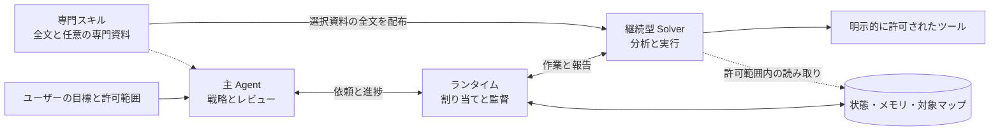

# DSH-CTF-Skill

[简体中文](README.md) | [English](README.en.md) | **日本語**

[](LICENSE) [](https://www.npmjs.com/package/@deepseek-ai/dsh) [](https://github.com/Cristallin2006/DSH-CTF-Mode/actions/workflows/synthetic.yml)

> **あなたの DeepSeek を、フルスタック CTF チームに。**

[DeepSeek Harness（DSH）](https://github.com/deepseek-ai/deepseek-harness) 向けの CTF・セキュリティ分析スキル集です。Web、リバースエンジニアリング、暗号、Pwn、Android、通信解析を扱い、必要に応じて継続型 Solver、構造化メモリ、証拠レビューを利用できます。


[主な機能](#主な機能) · [クイックスタート](#クイックスタート) · [使い方](#使い方) · [アーキテクチャ](#アーキテクチャ) · [評価記録](#ローカルモードの評価記録) · [ドキュメント](#ドキュメント)

## 主な機能

**分析方針はモデルが選び、ランタイムが状態を管理し、スキルが専門手法を提供します。** 単純なタスクは直接進め、分業の効果がある場合に編成を利用します。

| 機能 | できること | 詳細 |
|---|---|---|
| 専門スキル | Web、逆解析、暗号、Pwn、Android、フォレンジックと任意の参考資料 | [スキル一覧](skills/) |
| 単独・協調モード | CTF プリセットの選択と Web でのモード・準備状態の表示 | [CTF モード](docs/CTF-MODE.md) |
| 継続型 Solver | 独立した子セッション、進捗報告、途中の助言、同一 work の履歴を保った継続 | [編成スキル](skills/analysis-orchestration/SKILL.md) |
| メモリと手法の再利用 | 出典、条件、矛盾、改訂の管理。範囲を限定した参照と、匿名化・レビュー済み手法カード | [知識・手法ライブラリ](skills/analysis-memory/references/knowledge-library.md) |
| 対象マップと長いタスク | コンポーネント関係、目標の依存関係、作業範囲。長い指示・追記・結果の全文ページング | [対象マップ](skills/analysis-orchestration/references/target-map.md) · [長いタスク](skills/analysis-orchestration/references/long-tasks.md) |

<details>
<summary>最近追加した専門資料とツール</summary>

- **Web**：[WAF・許可リストの差分](skills/ctf-web/references/waf-allowlist-differentials.md)、[Elixir / BEAM アプリ](skills/ctf-web/references/elixir-beam-web.md)。
- **逆解析とファイル**：[BEAM 静的検査](skills/re-triage/references/beam-artifacts.md)、[保存済みチャンク結合](skills/re-triage/references/evidence-chunks.md)。
- **暗号とプロトコル**：[CRC モデルと oracle の条件](skills/ctf-crypto/references/crc-oracle-contracts.md)、[多層プロトコルと接続状態](skills/pwn-exploit/references/relay-session-contracts.md)。
- **ローカル Pwn**：[SQLite 拡張](skills/pwn-exploit/references/sqlite-extension.md)、[seccomp の証拠](skills/pwn-exploit/references/seccomp-evidence.md)、[多段階実験](skills/pwn-exploit/references/multi-stage-local.md)。
- **ランタイムと寿命**：[同梱ランタイム](skills/pwn-exploit/references/bundled-runtime.md)、[mallocng](skills/pwn-exploit/references/mallocng-evidence.md)、[libxml2](skills/pwn-exploit/references/libxml2-state-lifetime.md)、[nginx モジュール](skills/ghidra-static/references/nginx-module-analysis.md)。
- **Windows**：[ユーザーモード解析](skills/pwn-exploit/references/windows-pwn.md)、[ネイティブデバッグ観察](skills/re-dynamic/references/windows-debug-channel.md)。
- **実験ブランチのワークベンチ**：[受動的な検出、アドレス照合、証拠保存、MCP ホスト検査](docs/RE-WORKBENCH.md)。デバイス操作と静的書き込みは段階ごとに検証します。

現在の問題に応じて資料を選びます。必須スキルと選択した参照資料はホストが全文を渡し、他のスキルも引き続き検索できます。詳しくは[変更履歴](CHANGELOG.md)をご覧ください。

</details>

## クイックスタート

### 1. ローカルの実行例を試す

Python 3.10 以上が必要です。ターミナルで実行し、Windows では `python3` を `python` に置き換えてください。

```bash
git clone https://github.com/Cristallin2006/DSH-CTF-Mode.git
cd DSH-CTF-Mode
python3 examples/recovery/run.py
```

`"ok": true` が出れば成功です。合成データによるバイト復元例で、DSH、モデルサービス、実際の対象への接続は不要です。ネイティブ Solver とメモリ権限の例も[実行例一覧](examples/README.md)にあります。

### 2. インストール方式を選ぶ

| 方式 | 用途 | 次の手順 |
|---|---|---|
| スキルのみ | 既存の DSH に専門知識を追加したい | 下記のコマンドを実行 |
| 完全モード（実験的） | 状態管理、メモリ、継続型 Solver、CTF モード操作を使いたい | [CTF モードの手順](docs/CTF-MODE.md)で、ネイティブカードまたは独立 profile を選ぶ |

スキルのみのインストール：

```bash
python3 tools/doctor.py --mode skills
python3 tools/setup.py --mode skills          # プレビュー
python3 tools/setup.py --mode skills --apply  # 適用
```

完全モードには Linux/WSL、Node.js 24 以上、インストール済みの DSH が必要です。[入門ガイド](docs/QUICKSTART.md)に従い、状態の初期化、独自のモデル設定、ホストプラグインの登録を行ってください。更新前はバックアップし、既存タスクと子プロセスの終了を確認します。専門ツールは [TOOLSET](TOOLSET.md) を参照してください。

> このページは現在の **main** を説明しています。[v0.7.0 Preview](https://github.com/Cristallin2006/DSH-CTF-Mode/releases/tag/v0.7.0) は以前のアーカイブで、後から追加した機能を含みません。現在の機能には main のソースを使用してください。

## 使い方

ネイティブ CTF プリセットをインストール・有効化した後、**設定 → Agent プリセット → カスタム → CTF モード** を選択します。「自動判断 / 単独優先 / 協調優先」を設定でき、タイトル横に実際のモードと準備状態が表示されます。導入手順は [CTF モード](docs/CTF-MODE.md)をご覧ください。

主エージェントに自然言語で依頼します。

| 場面 | プロンプト例 |
|---|---|
| 1 問 | `<添付パス>` を分析し、関連スキルを選んで、再現スクリプト・証拠・検証結果を提出してください。許可範囲は `<範囲>` です。 |
| 独立した複数の対象 | `<問題ディレクトリ>` を編成モードで処理し、独立した対象ごとに分担してください。必要なスキルとツールを宣言し、各対象の状態を報告してください。 |
| 資料を追加して継続 | 新しい資料は `<パス>` にあります。元の work を見つけ、同じ Solver に followup し、影響する過去の結論を再評価してください。 |

途中の助言は主セッションに送り、主エージェントから Solver に渡します。受信、理解、実験による検証は区別します。介入、一時停止、再開の例は [Agent 操作ガイド](docs/AGENT-OPERATIONS.md)にあります。

## アーキテクチャ

以下は編成を有効にした場合の関係です。単独モードでは、主エージェントが専門スキルと既存ツールを直接使います。



主エージェントが判断・レビューし、Solver が具体的な作業を進め、ランタイムが状態・配布・権限を記録します。メモリ共有には範囲があり、重要な前提の変更には再レビューが必要です。詳しいデータフロー、ディレクトリ構成、適用範囲は[アーキテクチャ文書](docs/ARCHITECTURE.md)を参照してください。

## ローカルモードの評価記録

ユーザー提供の **TSecBench v1 ローカルモード**の過去の結果です。モデルのラベルは **Deepseek** です。

| テスト時刻 | 獲得点数 | 総合スコア | 画面上の達成率 | 正解 Flag | 満点の問題数 |
|---|---:|---:|---:|---:|---:|
| **2026-10-18 18:48** | **22300** | **96.94** | **95.9%** | **71/74** | **61/63** |

これはローカルの記録であり、公式ランキングの成績としては扱いません。画面にモデルの厳密なバージョンとコードのリビジョンがないため、現在の main や特定の変更による改善とは判断できません。[分野別の結果・以前の記録・評価の説明](docs/BENCHMARKS.md)をご覧ください。

## 互換性と検証

プラグインは **Linux/WSL、DSH 0.1.5-rc.3、Node.js 24.21.0、Python 3.10 以上**で検証しました。他のホストバージョンでは互換性を確認してください。Windows ネイティブの観察ツールもありますが、完全なホスト統合の検証環境は Linux/WSL です。

- 編成、対象マップ、プロジェクト手法ライブラリは任意の実験機能です。分業の効果は作業の独立性と引き継ぎコストによって変わります。
- 並列数とコンテキスト容量は設定・モデル・ホストによって決まります。長い資料は全文をページで読めますが、上流で失われた内容は復元できず、固定 1M の容量も保証しません。
- スキルやメモリは実行権限を増やしません。ツールの成功、結果の採用、実際の対象による受理を区別します。任意の HTTP 制御については[適用範囲](docs/ARCHITECTURE.md#能力边界与已知限制)を参照してください。

ローカル検証は合成入力と決定的なモデルアダプターを使い、実モデルや実際の対象を呼び出しません。回帰テストには Python 3.10 以上と Node.js 24 以上が必要です。

```bash
python3 tests/run.py
# 任意：DSH を導入した Linux/WSL のネイティブホスト検証
export DSH_NATIVE_PACKAGE_ROOT="$(npm root -g)/@deepseek-ai/dsh"
python3 tests/run.py --native
```

検証対象は仕組みです。実際の解題性能は別途評価する必要があります。[自動チェック](https://github.com/Cristallin2006/DSH-CTF-Mode/actions/workflows/synthetic.yml)はインストール、知識の契約、オフラインツール、編成の回帰を確認します。

## ドキュメント

詳細なスキル本文とリンク先のガイドは主に中国語です。

| 目的 | 読むもの |
|---|---|
| インストール・設定・更新 | [クイックスタート](docs/QUICKSTART.md) · [プラグイン統合](plugins/README.md) |
| 依頼・助言・一時停止・継続 | [Agent 操作ガイド](docs/AGENT-OPERATIONS.md) · [CTF プリセット](docs/CTF-MODE.md) |
| 設計とディレクトリ構成の理解 | [アーキテクチャと適用範囲](docs/ARCHITECTURE.md) |
| ツール準備と実行例 | [ツール環境](TOOLSET.md) · [実行例](examples/README.md) |
| 評価結果とバージョン変更 | [評価記録](docs/BENCHMARKS.md) · [変更履歴](CHANGELOG.md) |
| 問題報告と知識の提供 | [貢献ガイド](CONTRIBUTING.md) · [Issues](https://github.com/Cristallin2006/DSH-CTF-Mode/issues) |

## ライセンスと謝辞

独自コードは [MIT](LICENSE) で公開し、取り込んだ内容や派生部分には該当する上流の条件を保持します。コードの出典、設計の参考、知識の整理元は [THIRD_PARTY_LICENSES](THIRD_PARTY_LICENSES.md) に記載しています。
