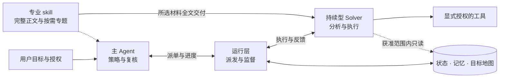

# DSH-CTF-Skill

**简体中文** | [English](README.en.md) | [日本語](README.ja.md)

[](LICENSE) [](https://www.npmjs.com/package/@deepseek-ai/dsh) [](https://github.com/Cristallin2006/DSH-CTF-Mode/actions/workflows/synthetic.yml)

> **让你的大肥鱼，变成一支全栈 CTF 团队。**

面向 [DeepSeek Harness（DSH）](https://github.com/deepseek-ai/deepseek-harness) 的 CTF 与安全分析技能库。覆盖 Web、逆向、密码学、Pwn、Android 和流量取证；可按任务启用持续型子代理、结构化记忆与证据复核。


[能力总览](#能力总览) · [快速开始](#快速开始) · [使用方式](#使用方式) · [架构](#架构总览) · [实测记录](#本地模式跑分记录) · [文档导航](#文档导航)

## 能力总览

**模型选择分析路线，运行层维护可靠状态，skill 提供专业方法。** 简单任务直接做；值得分工的任务再启用编排。

| 能力 | 你可以得到什么 | 入口 |
|---|---|---|
| 专业解题 | Web、逆向、密码学、Pwn、Android、取证等技能与按需参考资料 | [技能目录](skills/) |
| 单兵与协作 | CTF 预设选择单兵或编排；Web 提供模式与就绪状态控件 | [CTF 模式](docs/CTF-MODE.md) |
| 持续型 Solver | 独立子会话执行、进度监督、途中指导，同一 work 续做保留自身历史 | [编排说明](skills/analysis-orchestration/SKILL.md) |
| 记忆与经验复用 | 证据来源、条件、冲突与修订；按授权召回，复用经脱敏复核的方法卡 | [知识与方法库](skills/analysis-memory/references/knowledge-library.md) |
| 目标地图与长任务 | 组件关系、目标依赖和工作覆盖；长说明、续做消息与结果全文分页 | [目标地图](skills/analysis-orchestration/references/target-map.md) · [长任务](skills/analysis-orchestration/references/long-tasks.md) |

<details>
<summary>按方向浏览近期补强的知识与工具</summary>

- **Web**：[WAF 与白名单差异](skills/ctf-web/references/waf-allowlist-differentials.md)、[Elixir / BEAM 应用](skills/ctf-web/references/elixir-beam-web.md)。
- **逆向与制品**：[BEAM 静态清点](skills/re-triage/references/beam-artifacts.md)、[已保存分块组装](skills/re-triage/references/evidence-chunks.md)。
- **密码与协议**：[CRC 模型与 oracle 条件](skills/ctf-crypto/references/crc-oracle-contracts.md)、[分层协议与连接状态](skills/pwn-exploit/references/relay-session-contracts.md)。
- **本地 Pwn**：[SQLite 扩展](skills/pwn-exploit/references/sqlite-extension.md)、[seccomp 证据](skills/pwn-exploit/references/seccomp-evidence.md)、[多阶段实验](skills/pwn-exploit/references/multi-stage-local.md)。
- **运行时与对象寿命**：[自带运行时](skills/pwn-exploit/references/bundled-runtime.md)、[mallocng](skills/pwn-exploit/references/mallocng-evidence.md)、[libxml2](skills/pwn-exploit/references/libxml2-state-lifetime.md)、[nginx 模块](skills/ghidra-static/references/nginx-module-analysis.md)。
- **Windows**：[用户态分析](skills/pwn-exploit/references/windows-pwn.md)、[原生调试观察](skills/re-dynamic/references/windows-debug-channel.md)。
- **实验分支工作台**：[离线发现、地址核对、证据封存与 MCP 宿主检查](docs/RE-WORKBENCH.md)，设备控制与静态回写分阶段验收。

这些专题按当前问题选择。所选必需技能与参考卡由宿主全文交付，其他技能仍可发现；详细变更见 [CHANGELOG](CHANGELOG.md)。

</details>

## 快速开始

### 1. 先运行一个本地示例

需要 Python 3.10+；以下命令在终端执行，Windows 可将 `python3` 换成 `python`。

```bash
git clone https://github.com/Cristallin2006/DSH-CTF-Mode.git
cd DSH-CTF-Mode
python3 examples/recovery/run.py
```

看到 `"ok": true` 即通过示例。这是无需 DSH、模型服务或靶场的合成字节恢复演示；原生子代理与记忆授权演示见[可运行示例](examples/README.md)。

### 2. 选择安装方式

| 方式 | 适合谁 | 下一步 |
|---|---|---|
| 仅技能 | 已有 DSH，希望直接补充专业知识 | 运行下方安装命令 |
| 完整模式（实验性） | 希望使用状态、记忆、持续型 Solver 与 CTF 模式控件 | 按 [CTF 模式说明](docs/CTF-MODE.md)选择原生卡片或独立 profile 入口 |

仅技能安装：

```bash
python3 tools/doctor.py --mode skills
python3 tools/setup.py --mode skills          # 预览
python3 tools/setup.py --mode skills --apply  # 应用
```

完整模式需要 Linux/WSL、Node.js 24+ 和已安装的 DSH；还需初始化状态、配置自己的模型并注册宿主插件。已有安装升级前先备份、暂停任务并确认收尾，详见[入门指南](docs/QUICKSTART.md)。专业工具按方向准备，见 [TOOLSET](TOOLSET.md)。

> 本页介绍当前 **main** 分支。[v0.7.0 Preview](https://github.com/Cristallin2006/DSH-CTF-Mode/releases/tag/v0.7.0) 是较早的归档，未包含后续新增能力；体验当前功能请使用 main 源码。

## 使用方式

安装并启用原生 CTF 预设后，在 **设置 → Agent 预设 → 自定义 → CTF 模式** 选择。可设置“自动判断 / 优先单兵 / 优先编排”，标题旁查看实际模式与就绪状态。设置过程见 [CTF 模式](docs/CTF-MODE.md)。

直接给主 agent 下任务，例如：

| 场景 | 示例提示词 |
|---|---|
| 单题 | 请分析 `<附件路径>`，选择相关 skill，交付复现脚本、证据和验证结果。授权范围是 `<范围>`。 |
| 多个独立目标 | 请用编排模式处理 `<题库目录>`，按独立目标分工，声明所需技能与工具，逐项报告状态。 |
| 补材料续做 | 新材料在 `<路径>`，请找到原 work，用 followup 继续同一 Solver，并复核受影响的旧结论。 |

途中建议发送给主会话，再由主代理转交 Solver；消息送达、理解与实验验证分别核对。暂停、恢复、纠偏和完整提示词见 [Agent 操作手册](docs/AGENT-OPERATIONS.md)。

## 架构总览

下面展示启用编排后的主要关系。单兵任务由主代理直接使用专业 skill 和已有工具。



主代理负责判断与复核，Solver 负责具体工作；运行层记录状态、交付和授权。记忆按范围共享，重要前提变化后需重新复核。完整数据流、目录结构与运行边界见[架构文档](docs/ARCHITECTURE.md)。

## 本地模式跑分记录

用户提供的 **TSecBench v1 本地模式**历史结果，模型标签为 **Deepseek**：

| 测试时间 | 获得点数 | 综合得分 | 页面完成率 | 答对 Flag | 全对题数 |
|---|---:|---:|---:|---:|---:|
| **2026-10-18 18:48** | **22300** | **96.94** | **95.9%** | **71/74** | **61/63** |

这是本地记录，不代表官方榜单成绩。截图未标注具体模型版本或代码修订，不能归因为当前 main 或某次修改的收益。[分项结果、此前记录与评测说明](docs/BENCHMARKS.md)。

## 兼容性与验证

插件已在 **Linux/WSL、DSH 0.1.5-rc.3、Node.js 24.21.0、Python 3.10+** 环境验收；其他宿主版本需核对兼容性。Windows 专题包含原生观察工具，完整宿主集成的验收平台仍为 Linux/WSL。

- 编排、目标地图与项目方法库为可选实验能力；多代理的收益取决于任务独立性和交接成本。
- 并发与上下文容量取决于当前配置、模型和宿主。长材料支持全文分页，上游已经截断的内容无法补回，也不承诺固定 1M 上下文。
- skill 和记忆不增加执行权限；工具成功、结果被采纳与原目标接受分别判断。可选 HTTP 控制器的覆盖范围见[运行边界](docs/ARCHITECTURE.md#能力边界与已知限制)。

本地验证使用合成输入与确定性模型适配器，不调用真实模型或靶场。运行回归需要 Python 3.10+ 和 Node.js 24+：

```bash
python3 tests/run.py
# 可选：已安装 DSH 的 Linux/WSL 原生宿主验收
export DSH_NATIVE_PACKAGE_ROOT="$(npm root -g)/@deepseek-ai/dsh"
python3 tests/run.py --native
```

测试验证实现机制，真实解题效果需另行评估。[自动检查](https://github.com/Cristallin2006/DSH-CTF-Mode/actions/workflows/synthetic.yml)包含安装、知识契约、离线工具和编排回归。

## 文档导航

| 想做什么 | 阅读 |
|---|---|
| 安装、配置或升级 | [快速开始](docs/QUICKSTART.md) · [插件集成](plugins/README.md) |
| 下任务、指导 Solver、暂停或续做 | [Agent 操作手册](docs/AGENT-OPERATIONS.md) · [CTF 预设](docs/CTF-MODE.md) |
| 了解设计和目录结构 | [架构与运行边界](docs/ARCHITECTURE.md) |
| 准备分析工具或运行演示 | [工具环境](TOOLSET.md) · [可运行示例](examples/README.md) |
| 查看战绩或版本变化 | [评测记录](docs/BENCHMARKS.md) · [更新日志](CHANGELOG.md) |
| 反馈问题或贡献知识 | [贡献指南](CONTRIBUTING.md) · [Issues](https://github.com/Cristallin2006/DSH-CTF-Mode/issues) |

## 许可与致谢

原创代码以 [MIT](LICENSE) 发布，收录或衍生内容保留上游适用许可。代码来源、架构参考与知识归纳见 [THIRD_PARTY_LICENSES](THIRD_PARTY_LICENSES.md)。
