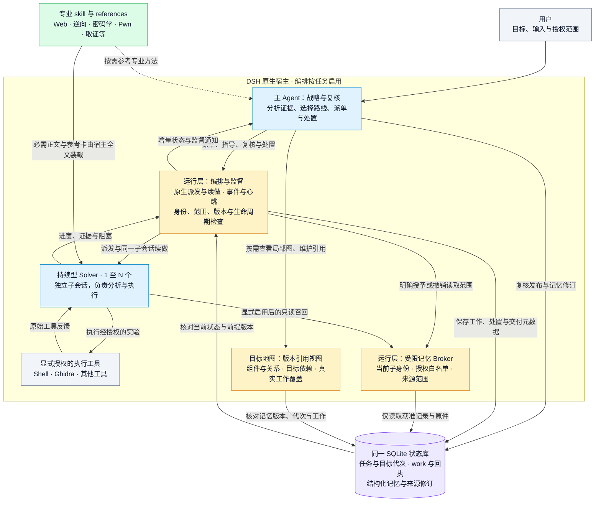

# 架构与运行边界

[返回首页](../README.md) · [Agent 操作手册](AGENT-OPERATIONS.md) · [CTF 预设](CTF-MODE.md)

下图展示启用编排后的职责与数据流。简单任务可由主代理直接使用专业 skill，无需启动 Solver。

- **模型负责判断**：主代理制定策略并复核结果，Solver 自主分析与执行；运行层不把一致意见或工具成功自动升级为正确结论。
- **skill 提供方法**：必需技能与参考卡在 Solver 推理前全文交付；其他技能仍可发现、按需读取。技能知识不授予额外执行权限。
- **记忆按范围共享**：主代理复核发布，Solver 仅在首次派单显式预留能力后获得受限只读召回；普通记忆写工具不下放。可选 Observer 保持零工具。
- **状态形成闭环**：工作、授权、交付与读取回执使用同一状态库；重要前提变化使旧处置失效。任务完成另需当前依据检查，重启仅恢复元数据，不自动重放执行。

实现与安装见[宿主插件](../plugins/README.md)，派单与技能交付见[编排 skill](../skills/analysis-orchestration/SKILL.md)，记忆授权与第二角度复核见[协作推理契约](../skills/analysis-orchestration/references/collaborative-memory.md)。

## 编排如何工作

1. 主代理读取 `analysis-orchestration` skill，用 `analysis_session init/bind` 绑定任务，再用 `dsh_memory_write open` 打开记忆。
2. `dsh_orchestration enable` 后，主代理保留阅读、状态与记忆工具，运行层限制其直接执行及其他派发渠道。`add` 写清问题、输入、判据和执行工具，`dispatch` 非阻塞启动 Solver。
3. Solver 默认获得 `skill` 和自身反馈工具，按需加载已安装且可调用的专业 skill；执行工具仍须显式授予。它不继承主代理完整对话或已加载的 skill 正文。可选 Observer 零工具，仅审查交接材料。
4. 主代理用 `wait/status/result/trace` 监督，以 `steer/followup` 补材料、纠偏或续做；Solver 可以提出有证据的异议。返回结果须 `review`，被采纳的结果修订后要重新复核。
5. 全部工作空闲后，按 `status.decision_review.signature` 调用 `resolve`，记录处置、未决问题及证据。`finish/disable` 可正常止损；总任务 `complete` 需要最新完成判断，不能用空未决列表绕过。

字段和例子见[编排 skill](../skills/analysis-orchestration/SKILL.md)、[监督契约](../skills/analysis-orchestration/references/supervision.md)与[目标处置](../skills/analysis-orchestration/references/resolution.md)。工具的 `schema` 返回当前动作字段。暂停或重启后不自动重放工作，核对状态后明确恢复。

## 能力边界与已知限制

- 编排为按任务启用的实验功能，依赖 DSH 原生 `startContinuable/sendMessage/drainContinuableChildren` 接口及生命周期事件；其他 DSH 版本需验证兼容性。插件使用现有 SDK，不扩大沙箱、审批、工具权限或递归派发权限。
- 并发取决于当前宿主和任务配置。长任务说明、续做消息和新收到的完整结果按版本保存，摘要与全文分页分开；模型或上游工具已经截断的内容不能由本层补回。子代理上下文容量由实际模型和宿主决定，不承诺固定 1M。大文件通过明确授权的原文件引用处理，见[长任务契约](../skills/analysis-orchestration/references/long-tasks.md)。
- `adopted`、工具返回成功和完成处置不等于独立验证或目标接受；引用存在也不证明结论正确。负面结论需说明测试条件与未覆盖范围。
- **请求控制是可选的宿主策略**：导入策略后，受控会话只能通过 `dsh_control` 发 HTTP(S)，预算、速率、origin 和凭据引用由该控制器管理。普通 shell、浏览器及 MCP 路径没有全局逐请求计量。严格 HTTP 控制尚不支持执行型 Solver，编排会拒绝启用，不能为此绕开原控制。
- 极端取消下曾观察到原生 hook 子进程启动失败后宿主退出等待未结束，根因尚未确认。已有生命周期修复覆盖编排数据库关闭顺序，不承诺解决原生 hook 链的全部退出问题；也未禁用生产钩子。

## 仓库结构

| 路径 | 能力 |
|---|---|
| `skills/ctf-web`、`ctf-misc`、`ctf-crypto` | Web、Misc、密码学知识库与诊断方法 |
| `skills/traffic-analysis` | pcap 分诊、隐信道、USB HID、WPA/TLS |
| `skills/ghidra-core`、`ghidra-static` | Ghidra headless RPC 引擎与静态分析 |
| `skills/re-*`、`vuln-audit`、`android-re`、`pwn-exploit` | 逆向、动态验证、代码分析、Android 与 Pwn；与 [ghidra-skill-for-dsh](https://github.com/Cristallin2006/ghidra-skill-for-dsh) 同源 |
| `skills/analysis-session`、`analysis-memory` | 任务、目标代次、证据、资源租约、结构化记忆及材料交接 |
| `skills/analysis-orchestration` | 专职编排、持续型 Solver、监督与完成判定的方法和契约 |
| `runtime/analysis-v1` | Python/SQLite 状态运行库 |
| `plugins/` | DSH 宿主插件：状态适配、记忆、可选请求控制、实验性编排 |
| `dsh-hooks/` | 会话卡与状态钩子入口、配置片段和合并脚本 |
| `tests/` | 隔离的合成回归，不调用外部模型或靶场 |
